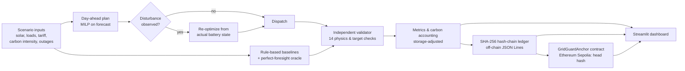

# GridGuard: Resilience-first microgrid dispatch with verifiable decisions

**IEEE ClimateChain Global Hackathon 2026 · Track: Renewable Energy & Grid Management**

**Live demo:** https://gridguard-microgrid.streamlit.app · **Code:** https://github.com/ruchii-prasad/gridguard

> **All inputs are synthetic and all results are simulated estimates.** Nothing in this repository
> is a measurement of real-world energy, cost or emissions.

## The problem

Campus, hospital and village microgrids combine solar, a battery and a weak or unreliable grid
connection. Most battery controllers in the field follow fixed rules: charge from surplus
solar, discharge when short. Those rules don't look ahead. They empty the battery just before an
outage, waste midday solar, and ignore when the grid is cleanest. Operators, funders and
carbon-credit buyers also have no tamper-evident record of *why* the system did what it did.

## What GridGuard does

1. **Optimizes dispatch.** A mixed-integer linear program (SciPy + HiGHS) schedules solar, battery
   charge/discharge, grid import, critical loads and flexible loads every 15 minutes over 24 h.
   It minimizes electricity cost plus priced emissions, with a strict priority order:
   critical load > flexible load > end-of-day battery target > cost.
2. **Re-plans after disturbances.** It plans day-ahead on a forecast, then re-optimizes from the
   real battery state when a solar drop, grid outage or demand spike is observed.
3. **Reports shortfalls honestly.** When physics makes it impossible to serve critical load (for
   example a 55 kW load and a 50 kW battery during an outage), it reports the exact unavoidable
   shortfall instead of hiding it.
4. **Proves its decisions weren't altered.** Every dispatch is written to a SHA-256 hash-chained
   audit ledger. The ledger's head hash can be anchored to a smart contract on the public
   Ethereum Sepolia testnet, so anyone can detect a rewritten or truncated record without a wallet.

## Results (simulated, 24 h, 200 kWh battery)

Compared against a **strong rule-based baseline** (solar self-consumption, plus flexible load
that follows solar surplus), not a strawman. Costs and emissions are *storage-adjusted*: each
controller is charged for battery energy it drew down by end of day.

| Scenario | Cost | CO₂e | Critical load unserved |
|---|---|---|---|
| Normal day | **−5.2 %** (₹3,375 vs ₹3,559) | −0.4 % | 0 vs 0 kWh |
| Solar drops to 20 % for 3 h | **−8.7 %** | **−3.7 %** | 0 vs 0 kWh |
| Grid outage 18:00–21:00 | +2.1 % | +4.7 % | **15.0 vs 34.6 kWh (−57 %)** |
| Critical demand +60 kW | −3.8 % | −0.3 % | 0 vs 0 kWh |
| Monsoon day, flat tariff | −0.4 % | **−4.1 %** | 0 vs 0 kWh |

Against the basic self-consumption controller (no flexible-load shifting), the normal-day gains
are −30.8 % cost and −21.4 % CO₂e, mostly from moving flexible load into midday solar.

**Resilience sweep.** For an unannounced 3 h outage starting at each even hour, critical energy
unserved falls from 112 to 12 kWh (20:00 start), 82 to 44 kWh (02:00) and 70 to 32 kWh (04:00).
With advance notice (for example scheduled load-shedding), the 02:00 and 04:00 cases fall to 0.

**Honest trade-offs.** In the outage, GridGuard imports more grid energy beforehand to keep
critical loads running, so emissions rise 4.7 %. On sunny days with a time-of-day tariff,
the carbon price changes nothing, because price and carbon already agree. It matters on low-sun,
flat-tariff days, where it cuts CO₂e by 4.1 % at no extra cost.

## Try it

**Live:** open the demo link above, pick a scenario in the sidebar, then explore the tabs:
Overview, Dispatch, Constraint checks, Audit ledger (append, verify, tamper test, blockchain
anchor), Outage sweep and Carbon trade-off.

**Locally** (Python 3.11+):
```bash
git clone https://github.com/ruchii-prasad/gridguard && cd gridguard
python3 -m venv .venv && .venv/bin/pip install -r requirements-dev.txt
bash run_all.sh                    # 81 tests + all scenarios + sweeps + tamper demo + validation
.venv/bin/streamlit run app.py     # dashboard at http://localhost:8501
```
`run_demo.py` prints a results fingerprint (`ce6f75ffc6d4`). Any machine that reproduces the
numbers prints the same value; we checked this on Linux and macOS.

**Blockchain anchor** (optional, testnet only, free):
```bash
.venv/bin/python run_chain_anchor.py deploy   # deploy GridGuardAnchor to Sepolia
.venv/bin/python run_chain_anchor.py anchor   # publish the ledger head hash
.venv/bin/python run_chain_anchor.py verify   # read-only check, no wallet needed
```
The private key is asked for with a hidden prompt and never stored. Use a fresh testnet-only wallet.

## How it works



| Component | File | Role |
|---|---|---|
| Physics model | `src/microgrid.py` | Power balance, battery dynamics, sign convention |
| Optimizer | `src/optimizer.py` | MILP, binary charge/discharge exclusivity, lexicographic tie-break, polish LP |
| Baselines | `src/baseline.py` | Self-consumption and solar-following-flex rule controllers |
| Scenarios | `src/scenarios.py` | Normal, solar shock, outage, demand spike, monsoon; re-optimization; oracle |
| Validator | `src/validation.py` | Independent checker applied to every controller |
| Carbon | `src/carbon.py`, `src/metrics.py` | Emissions at import time; volume vs timing decomposition |
| Ledger | `src/ledger.py` | Hash chain, verify, export, anchored-prefix check |
| Blockchain | `contracts/GridGuardAnchor.sol`, `src/chain.py` | Append-only on-chain anchor; deploy, anchor, verify |
| Dashboard | `app.py` | Streamlit + Plotly |

Details: [`docs/methodology.md`](docs/methodology.md) (equations and design choices) ·
[`docs/security.md`](docs/security.md) (security and data-integrity assessment) ·
[`docs/validation.md`](docs/validation.md) (test results, assumptions, limitations) ·
[`docs/impact.md`](docs/impact.md) (climate impact, adoption and scalability).

## Validation in one paragraph

81 automated tests cover hand-calculated physics cases, every constraint, carbon accounting,
ledger tamper detection, the smart contract (on an in-process EVM) and 25 randomized microgrids.
A further 300-case random stress test found zero violations (worst 1 × 10⁻¹³). The optimizer is
never worse than either baseline on its own objective, and the oracle is never beaten. That holds
by construction, and the tests check it.

## Limitations

Synthetic profiles. Single-bus energy model (no voltage, frequency or line losses). Forecasts are
perfect until a disturbance is observed. Carbon-intensity shapes are illustrative. The blockchain
anchor runs on a public testnet from a single publisher key, and it proves records were not
changed, not that they were true. See `docs/validation.md` §4.

## License

MIT
